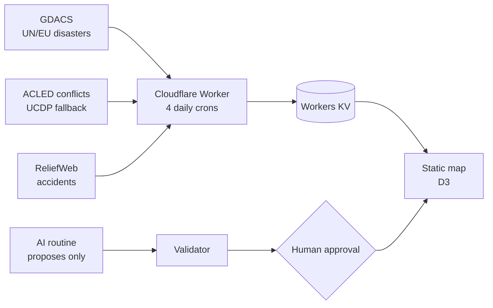

# mapa-emergencial

> A world map of active emergencies, where every marked country links to its official source.

## What it is

A red-and-black **world map of active emergencies**: natural disaster alerts,
armed-conflict activity, environmental/technological accidents, and **official
civil-preparedness guidance** per country (e.g. governments telling people to
stock water and food). It runs as a single **Cloudflare Worker** on the free
plan and refreshes itself every day.

## Why

That information exists, but it is scattered across UN systems, research
datasets and dozens of government sites. I wanted one map where **every marked
country links to its official source** — and where nothing appears without one.

## How it works

- **Daily crons on the Worker** pull disaster alerts from GDACS (UN/EU),
  conflict data from ACLED with the public UCDP monthly file as a fallback,
  and accidents from ReliefWeb (OCHA). Results are cached in **Workers KV**.
- **Civil-preparedness data is human-approved:** an AI routine only *proposes*
  changes, a validator script checks them, and nothing goes on the map without
  my OK. Entries not re-verified in 30 days are flagged as stale.
- **Performance under the free plan:** the Free plan allows ~10 ms of CPU per
  invocation. Profiling the ACLED aggregation showed date parsing was the cost;
  caching parsed dates made it **~20× cheaper** (~20 ms → ~1 ms), and the UCDP
  fallback moved to its own cron so each run stays inside the limit.
- **Security:** strict security headers (CSP, HSTS, frame-ancestors) on both
  the Worker and the static assets — checked by tests — and no secrets in the
  repository.

## Stack

JavaScript · Cloudflare Workers (static assets, Cron Triggers, KV) · Wrangler ·
D3 · Vitest (188 tests) · GDACS / ACLED / UCDP / ReliefWeb

## Demo

<!-- DEMO_URL -->

## What I learned

- Building a serverless app with scheduled jobs and a key-value cache within
  free-tier limits — and measuring before optimizing.
- Designing for data you can't fully trust: every entry needs a source, AI only
  proposes, a human approves, and stale data is labeled.
- Treating content read from the web as data, not instructions, when an AI
  routine is involved (least-privilege permissions for the routine).

## Source code

The source code is private. It is available on request for hiring processes —
reach me through my GitHub profile.

---

🇧🇷 Mapa-múndi de emergências ativas com fonte oficial em cada país, num único Cloudflare Worker.

© 2026 Felipe Mendes. All rights reserved. Data belongs to its sources (UCDP: CC BY 4.0).
